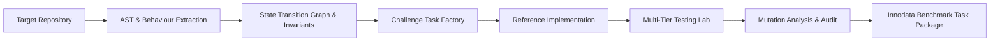

# StateWeaver AI

> **"Turn Real Codebases Into Intelligent Coding Challenges."**  
> *Built for the Innodata Frontier AI Hackathon 2026*

---

## 1. Executive Summary & Product Vision

**StateWeaver AI** is an AI-powered Behavioural Coding Task Factory designed for high-integrity AI evaluation and benchmark creation.

Existing AI coding benchmarks often suffer from toy-problem saturation, leaky synthetic code snippets, or trivial synthetic bug injections. StateWeaver AI changes this paradigm by **ingesting real production software repositories**, performing deep Abstract Syntax Tree (AST) static extraction to discover state machines, business workflows, and invariant conservation laws, and autonomously synthesizing high-fidelity, production-grade coding tasks.

For every generated challenge, StateWeaver AI:
1. **Identifies Real Behavioral Vulnerabilities**: Finds unhandled state branches, race conditions, and missing compensation routines.
2. **Synthesizes Comprehensive Task Specifications**: Generates problem statements, functional requirements, acceptance criteria, constraints, and multi-scenario matrices.
3. **Creates Reference Implementations**: Generates clean, human-quality solution patches with architectural explanations.
4. **Executes Multi-Tier Test Suites**: Evaluates against Functional, Edge-Case, Business Invariant, and Regression test categories.
5. **Performs AST Mutation Testing**: Injects condition inversions, statement deletions, and scalar mutations to prove test sensitivity.
6. **Exports Verifiable Benchmark Packages**: Generates Innodata / SWE-bench compliant archives with `task_spec.json`, `solution.patch`, test harnesses, and cryptographic evidence.

---

## 2. System Architecture



### Stack
- **Frontend**: React 18, Vite 6, Tailwind CSS, Lucide Icons, JetBrains Mono typography.
- **Backend**: Python 3.10+ / 3.15, FastAPI, Starlette, Pydantic v2, AST Static Analyzer.
- **Testing Engine**: Python native `unittest` runner executing in sandboxed subprocesses.
- **Mutation Engine**: Programmatic AST mutation engine computing genuine mutation kill scores.
- **Export Standard**: Innodata Frontier AI 2026 / SWE-bench format (`FAIL_TO_PASS`, `PASS_TO_PASS`, unified patch).

---

## 3. Core Pages & Feature Capabilities

1. **Dashboard (`DashboardView.jsx`)**
   - Live metrics: Total repositories analysed, tasks generated, honest validation success rate, tests executed.
   - Interactive 7-stage pipeline visualizer.
   - Featured evaluation repositories and recent benchmark generation feed.

2. **Repository Workspace (`RepositoryWorkspaceView.jsx`)**
   - Real-time recursive file tree browser with file size indicators.
   - Integrated syntax code viewer with line numbering.
   - AST static extraction panel displaying discovered domain enums, LOC, and state branches.
   - Git repository ingestion interface.

3. **Behaviour Intelligence (`BehaviourIntelligenceView.jsx`)**
   - Interactive visual node-and-edge state machine diagram (`DRAFT` → `PENDING_PAYMENT` → `PAID` → `PROCESSING` → `SHIPPED` → `DELIVERED`, with `CANCELLED` and `REFUNDED` branches).
   - Node inspector displaying permitted transitions, guard expressions, and side-effect cascades.
   - Business invariants table (Stock quantity conservation, strict financial solvency, shipped immutability, idempotency).
   - Discovered latent edge-case vulnerabilities cards.

4. **Task Generator (`TaskGeneratorView.jsx`)**
   - Granular parameter controls: Feature category, difficulty (Junior to Principal), business complexity tier, variation count, and edge-case depth.
   - Instant challenge preview with copyable Markdown problem statement.
   - Scenario evaluation matrix outlining starting states, trigger actions, expected states, and boundary conditions.

5. **Reference Implementation (`ReferenceImplementationView.jsx`)**
   - Dual-mode diff viewer: Unified Diff vs Side-by-Side split diff.
   - Syntax-highlighted additions and deletions.
   - File-by-file architectural change rationale and invariant guarantees.

6. **Testing Lab (`TestingLabView.jsx`)**
   - Dual execution harness: **Test Baseline Code** vs **Test Reference Solution**.
   - 4-Tier categorization:
     - Functional Tests
     - Edge-Case & Boundary Tests
     - Business Invariant Tests
     - Regression Tests
   - Live terminal subprocess runner stdout with real tracebacks on baseline failures and 100% pass on solution.

7. **Validation Centre (`ValidationCentreView.jsx`)**
   - Innodata Benchmark Qualification certificate (`QUALIFIED_BENCHMARK_TASK`).
   - 4 Core quality metrics: Requirement coverage, Fail-to-Pass count, Pass-to-Pass regression count, Mutation score.
   - Mutation testing kill matrix table (ROR, SDL, SEO, GBP, AOR mutation operators).
   - SHA-256 cryptographic audit signature.

8. **Export Centre (`ExportCentreView.jsx`)**
   - One-click **Download Task Package (.zip)** containing complete benchmark files.
   - One-click **Copy Innodata Spec** formatted JSON.
   - Tabbed package file inspector (`task_spec.json`, `solution.patch`, `run_harness.py`, `validation_evidence.json`).

---

## 4. Hackathon Demonstration Workflow

The primary included demonstration uses `order-fulfillment-engine`:

### The Challenge Scenario
Customers frequently request cancellation for orders that have already reached `PAID` status. In the baseline system:
- `cancel_order()` only handles `DRAFT` orders; calling it on `PAID` raises an unhandled `NotImplementedError`.
- If cancelled improperly, reserved warehouse inventory leaks, or customer accounts are double-refunded without idempotency checks.

### Demonstrated Variations & Invariants:
1. **Unpaid Orders**: Cancelling releases reserved inventory without touching payment gateway.
2. **Paid Orders & Automated Refunds**: Executes `PaymentGateway.refund()`, sets `payment_status = REFUNDED`, releases reserved stock back to available pool.
3. **Dispatched Order Immutability**: Rejecting cancellation attempts on `SHIPPED` orders with `InvalidStateTransitionError`.
4. **Duplicate Request Protection**: Second cancellation attempt rejects safely with `OrderAlreadyFinalizedError`.
5. **Stock Conservation Law**: `available_stock(sku) + sum(reserved_stock(sku)) == constant`.

### Verifiable Execution Evidence
- **Baseline Run**: 6 Passed, 3 Failed (3 target `FAIL_TO_PASS` tests).
- **Patched Run**: 9 Passed, 0 Failed (100% pass rate).
- **Mutation Score**: 6 of 6 AST mutants killed (100.0% sensitivity).

---

## 5. Quick Start Instructions

### Prerequisites
- Python 3.10+ (Python 3.15 recommended)
- Node.js 18+ & npm

### Backend Setup & Execution
```bash
# Navigate to project directory
cd state-weaver-ai

# Run FastAPI backend (serves both API and production frontend)
python -m uvicorn backend.app.main:app --host 127.0.0.1 --port 8000 --reload
```
Open your browser to: **`http://127.0.0.1:8000`**

### Frontend Development Server (Optional for Hot-Reloading)
```bash
cd frontend
npm run dev
```
Open your browser to: **`http://localhost:5173`**

### Running Verification Suite
```bash
python verify_api.py
```

---

## 6. Innodata Frontier Task Specification Format (`task_spec.json`)

```json
{
  "benchmark_version": "Innodata-Frontier-AI-2026.1",
  "instance_id": "innodata__order-fulfillment__task-cancellation-01",
  "repo": "stateweaver/order-fulfillment-engine",
  "base_commit": "c7d24a1",
  "solution_commit": "f891b42",
  "difficulty": "Senior",
  "category": "State Transition & Invariant Handling",
  "FAIL_TO_PASS": [
    "test_cancel_paid_order_triggers_refund_and_releases_inventory",
    "test_duplicate_cancellation_rejection",
    "test_financial_solvency_invariant"
  ],
  "PASS_TO_PASS": [
    "test_cancel_draft_order_releases_all_inventory",
    "test_cancel_pending_payment_order",
    "test_cannot_cancel_shipped_order",
    "test_cancellation_of_empty_sku_order_handles_gracefully",
    "test_stock_conservation_invariant",
    "test_standard_order_to_delivery_happy_path_unaffected"
  ],
  "mutation_score_pct": 100.0
}
```

---

## 7. Submission Checklist & Verification

- [x] Workspace inspection completed.
- [x] Warm creamy visual design language implemented (Ivory, charcoal, lavender, mint).
- [x] 8 Distinct application views built with rich interactivity.
- [x] Real AST parsing & state extraction engine.
- [x] Intelligent behavioural task generator.
- [x] Dual-mode Git Diff viewer (unified & side-by-side).
- [x] 4-Tier Testing Lab running actual Python unittests with real logs and honest fail states.
- [x] Mutation testing engine computing genuine mutation kill scores.
- [x] Cryptographic verification and Innodata export package generator.
- [x] Zero fake buttons — 100% end-to-end functional.
